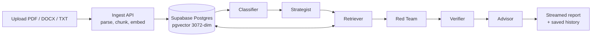

# Vanguard — Multi-Agent RAG for Contract Risk


Upload a contract (PDF, DOCX or TXT) and a six-step LangGraph pipeline finds the clauses that can hurt you: auto-renewals, one-sided termination, uncapped indemnities, broad IP assignment, forced arbitration and missing protections. Every reported risk quotes the exact clause from your document, rates its severity, explains what actually happens if it is triggered, and suggests what to negotiate.

**Live demo:** https://lexguard-ogu3.vercel.app/ (create an account with email and password to run an analysis)

> The repository is named `lexguard`; the product was renamed to **Vanguard**.

---

## The problem

Most people sign employment offers, SaaS terms, rental agreements and vendor contracts without a lawyer. The expensive parts are rarely on page one: they sit in dense clauses about renewal, liability, termination and jurisdiction. Vanguard gives a non-lawyer a severity-ranked list of those clauses, grounded in the actual text, before they sign.

## How it works



### Ingestion (`/api/ingest`)

1. Rejects files over 4.5 MB (Vercel's request limit) and unsupported types.
2. Stores the original file on Cloudinary.
3. Extracts text with `unpdf` (PDF), `mammoth` (DOCX) or reads it directly (TXT). Encrypted files and scanned PDFs with no text layer are rejected with a clear message.
4. Splits text with LangChain's `RecursiveCharacterTextSplitter` (1,200 characters, 250 overlap).
5. Embeds each chunk with `gemini-embedding-001` (3,072 dimensions) in batches of 12 and bulk-inserts into `document_chunks`.

### Analysis pipeline (`/api/analyze`)

A LangGraph `StateGraph` with six nodes. Each node reads and writes a typed shared state (`src/agents/state.ts`).

| # | Node | Model | What it does |
|---|------|-------|--------------|
| 1 | **Classifier** | Llama 3.1 8B Instant (Groq) | Reads an excerpt of the contract and writes one sentence naming the contract type and parties. Zod-validated. |
| 2 | **Strategist** | Llama 3.1 8B Instant (Groq) | Picks the 4 most critical risk categories for *this* type of contract and writes 3 keyword-dense search queries per category (12 total). |
| 3 | **Retriever** | `gemini-embedding-001` + pgvector, Llama 3.1 8B rerank | Embeds all 12 queries in one batched call, runs 12 parallel similarity searches scoped to this document (top 5 each, similarity > 0.5), de-duplicates by chunk ID, and, if more than 15 chunks remain, has an LLM keep the most risk-relevant ones (max 15). |
| 4 | **Red Team** | Gemini 2.5 Flash | Plays aggressive opposing counsel. Flags hidden fees, renewal traps, one-sided termination, liability and indemnity exposure, hostile jurisdiction, vague terms and missing protections, each with severity and the quoted clause. |
| 5 | **Verifier** | Gemini 2.5 Flash | Checks every Red Team claim against the retrieved source text. Deletes any claim the text doesn't support, rewrites the clause to its exact wording, and tones down exaggeration. Zod-validated. |
| 6 | **Advisor** | Llama 3.3 70B Versatile (Groq) | For each verified risk: the trap in one sentence, the real-world consequence, and what to ask for. Ends with an overall verdict: sign, negotiate, or walk away. Zod-validated. |

Models are split by job: small, fast tasks run on Groq; the two steps that must read every retrieved clause run on Gemini 2.5 Flash for its long context window. This also spreads load across two providers' free-tier rate limits.

### Reliability

- **Retries:** every model call goes through `withRetry` (`src/lib/withRetry.ts`): up to 3 attempts. Rate-limit (429 / quota) errors back off exponentially (2 s, then 4 s), other transient errors retry after 2 s, and 400 / 500 errors fail immediately.
- **Timeouts with fallbacks:** each node races a hard timeout (Strategist and reranker 15 s, Verifier and Advisor 60 s, Red Team 90 s). If the reranker times out, the top 15 vector matches are used; if the Verifier times out, the Red Team's risks are passed through.
- **Readable errors:** when a node hits a rate limit or timeout it returns `{ status: "error", uiMessage }` instead of throwing, and the frontend shows that message and stops the spinner. Other failures degrade to a safe default so the run still finishes.
- **Document isolation:** the vector search filters on `document_id`, so one user's contract never appears in another's results.
- **Exact search:** pgvector's HNSW index supports at most 2,000 dimensions, so retrieval uses exact nearest-neighbour search, which is fast at the scale of one document.

### Frontend

- Next.js 16 App Router, React 19, Tailwind CSS 4.
- The analysis response streams as NDJSON, one line per finished node, so the UI shows progress live. Requests can be cancelled (`AbortController`).
- Email and password sign-in with Supabase Auth.
- Finished reports are saved to a `reports` table protected by Row Level Security; the history sidebar updates through a Supabase Realtime subscription.
- Risk cards are colour-coded by severity (Critical, High, Medium, Low), and a report can be exported to PDF (`html-to-image` + `jsPDF`).

## Tech stack

| Area | Tools |
|------|-------|
| App | Next.js 16, React 19, TypeScript, Tailwind CSS 4 |
| Agents | LangGraph.js, LangChain.js, Zod |
| Models | Gemini 2.5 Flash, `gemini-embedding-001`, Llama 3.1 8B Instant and Llama 3.3 70B Versatile on Groq |
| Data | Supabase (Postgres, pgvector, Auth, Row Level Security, Realtime) |
| Files | Cloudinary, `unpdf`, `mammoth` |
| Hosting | Vercel |

## Project structure

```
src/
├── agents/
│   ├── graph.ts            # LangGraph wiring: classifier → … → advisor
│   ├── state.ts            # Shared graph state and report types
│   └── nodes/              # classifier, queryExpander (Strategist), retriever,
│                           # redTeam, verifier, advisor
├── app/
│   ├── api/ingest/         # Upload, parse, chunk, embed, store
│   ├── api/analyze/        # Runs the graph and streams NDJSON
│   ├── login/              # Sign in / sign up
│   └── page.tsx
├── components/             # Dropzone, ThreatMatrix, RiskCard, Sidebar, …
├── hooks/                  # useContractAnalysis (upload + stream), dashboard state
├── lib/                    # withRetry, Supabase and Cloudinary clients, PDF export
└── utils/supabase/         # Server, browser and middleware Supabase clients
supabase/migrations/        # pgvector tables and the reports table with RLS
```

## Running locally

**1. Install**

```bash
git clone https://github.com/LAKSHYAMEWARA0025/lexguard.git
cd lexguard
npm install
```

**2. Environment variables** — create `.env.local`:

```env
GOOGLE_API_KEY=            # Gemini chat + embeddings
GROQ_API_KEY=              # Llama models on Groq

NEXT_PUBLIC_SUPABASE_URL=
NEXT_PUBLIC_SUPABASE_ANON_KEY=
SUPABASE_SERVICE_ROLE_KEY= # used server-side only

CLOUDINARY_CLOUD_NAME=
CLOUDINARY_API_KEY=
CLOUDINARY_API_SECRET=
```

**3. Database** — in your Supabase project, run the two files in `supabase/migrations/`, then create the search function the Retriever calls:

```sql
create or replace function match_document_chunks (
  query_embedding vector(3072),
  match_threshold float,
  match_count int,
  filter_document_id uuid
)
returns table (id uuid, document_id uuid, content text, similarity float)
language sql stable
as $$
  select id, document_id, content,
         1 - (embedding <=> query_embedding) as similarity
  from document_chunks
  where document_id = filter_document_id
    and 1 - (embedding <=> query_embedding) > match_threshold
  order by embedding <=> query_embedding
  limit match_count;
$$;
```

**4. Run**

```bash
npm run dev
```

Open http://localhost:3000, sign up, and drop in a contract.

## Limitations and next steps

- Scanned PDFs need OCR; today they are rejected.
- Files are capped at 4.5 MB, and a full run must finish within one serverless request (300 s limit).
- If the Verifier times out, unverified risks are shown; they should be labelled as such.
- Planned: per-user rate limiting, an evaluation set (for example CUAD) to measure precision and recall, LangSmith tracing, and Zod schemas on every node.

## Disclaimer

Vanguard is an experimental tool for education and transparency. It is not legal advice and does not replace a qualified lawyer. Always have a lawyer review significant contracts before you sign.
